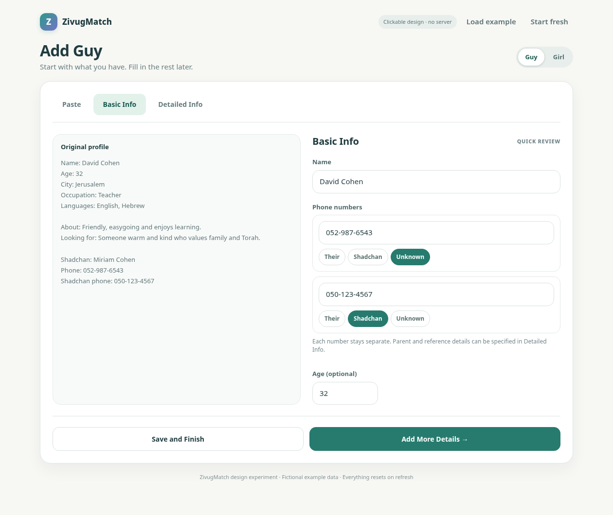
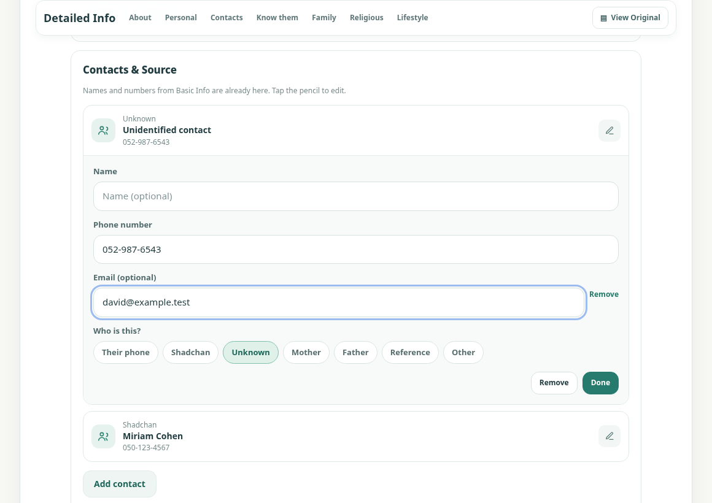
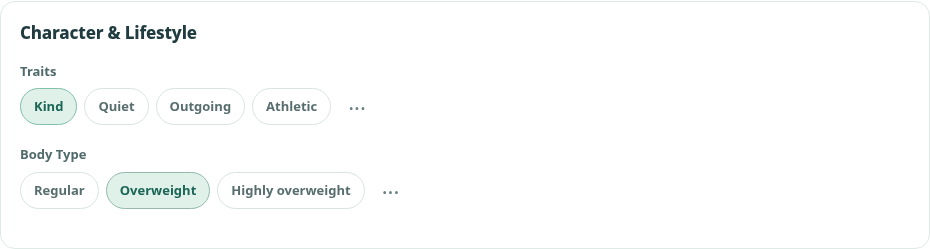

Add Person & Shadchan — Intake Forms

ZivugMatch \| Version 4 \| Approved design decisions through 13 October 2026

Scope The original Shidduchim Version 1 specification is retained without changing its decisions. This addendum describes Add Guy/Girl and Add Shadchan forms, based on the reviewed interactive prototype.

Status User-reviewed design reference only. The companion HTML is an interactive visual prototype; it does not persist contacts or implement production extraction, file storage, or a backend.

# Quick function list

- AP-01 Add Person — Paste, Basic Info, Detailed Info; adaptive layout. REVIEWED

- AP-02 Paste — retain original; attach files; Save for later or Next. REVIEWED

- AP-03 Basic Info — name, optional age, phone ownership; quick save. REVIEWED

- AP-04 Detailed Info — full-width fields, fixed section shortcuts, View Original. REVIEWED

- AP-05 Contacts & Source — named contact cards, phones, references, optional email. REVIEWED

- AP-06 Personal, religious, Character & Lifestyle, and familiarity information. REVIEWED

- AP-07 Custom and built-in categories and bubble choices — add, hide, delete and arrange; preserve saved values. REVIEWED

- AP-08 Data/behavior — preserve source, sensible extraction, no mixing contacts. REVIEWED

- AP-09 Personal receiving link / online inbox. FUTURE DESIGN (NOT FINALIZED)

# Core experience

Paste an existing profile → Next to confirm the essentials → Save and Finish, or Add More Details. Everything else is optional.

Do not build a large intake dashboard or require the user to fill in complete profiles. The original profile remains available and the app should organize extracted information, not make users retype it.

Companion file: ZivugMatch_Add_Person_Prototype_v3_0.html (clickable local design demo, packaged separately). Open it in a browser; Word cannot run its interactions. The document includes additional settings decisions that are not yet implemented in the HTML.

# AP-01 — Three tabs and responsive layout

| **Tab**       | **When no original exists** | **When pasted/attached original exists**  |
|---------------|-----------------------------|-------------------------------------------|
| Paste         | Full-width input            | Full-width input / attached files         |
| Basic Info    | Full-width form             | Original on left, editable form on right  |
| Detailed Info | Full-width form             | Full-width form with View Original button |

- Tabs at top: Paste → Basic Info → Detailed Info. Switching tabs must not lose changes.

- Basic Info keeps the original visible on the left for direct comparison; adapt spacing on narrow phones without requiring dropdowns for phone ownership.

- Detailed Info uses full width so category sections and contacts are not cramped. View Original opens a temporary readable, scrollable overlay/drawer and returns to exactly where the user was.

- All Detailed Info sections stay open; no collapsing/expanding just to reach a field. Distinct softly outlined, rounded sections separate the content.

- A slim, fixed/sticky line of category names beside “Detailed Info” jumps straight to a section. No Jump-to dropdown. On phones this line scrolls horizontally.

# AP-02 — Paste and Basic Info

**Starting point** Paste

- A prominent “Paste a profile” button reads text from the clipboard in one click where browser permission allows, to save a manual paste. The full-width profile text box remains editable and supports ordinary Ctrl and V together when clipboard access is blocked. Allow attaching files and preserve the original.

- Bottom buttons: Save for later \| Next. Save for later preserves the item without forcing a person record; Next goes to Basic Info.

- Extract known fields from the source whenever reliable; missing/uncertain values stay empty, never invented.

**Exactly three types of fields** Basic Info

- Name — editable and automatically filled if found.

- Phone number rows — one per extracted number, with a minimum of one blank row when none is found; editable individually.

- Age (optional) — editable; never invent birthdate or extrapolate a current age from an undated old profile.

- Each phone sits within its own clearly outlined card. Put the short prompt “Whose number is this?” immediately ABOVE the one-tap role buttons, so their purpose is obvious. The number and owner/role selector remain visually tied together.

- Basic Info and Detailed Info use the same clearly labeled one-tap role choices: Their phone, Shadchan, Unknown, Mother, Father, Reference and Other; no role dropdown.

- Unknown is the default when the owner cannot be determined. Never turn a shadchan, parent or reference number into the person’s direct number.

- Bottom row: Save and Finish (left) \| Add More Details (right). Both save. Save and Finish closes; Add More Details opens Detailed Info for the same person.

Reference AP-A — Basic Info desktop concept: original on left, editable essentials and separate phone cards on right.

# AP-03 — Detailed Info organization

Opening sections: About & Looking For; Personal Info; Contacts & Source; How well do I know them?; Status; Religious; Character & Lifestyle; user-defined categories; and Attached items at the end.

Each section stays expanded (never require a click to open it) and is visually separated with clear spacing/borders. The slim category shortcut row stays accessible while scrolling; tapping a name scrolls directly to that category. Do not insert an extra Jump-to dropdown.

View Original stays near the Detailed Info title. The original is read-only, scrollable and dismissible without clearing the form or changing the scroll position.

# AP-04 — Main information fields

| **Section**              | **Field / UI**                                                                                                                                                                    |
|--------------------------|-----------------------------------------------------------------------------------------------------------------------------------------------------------------------------------|
| About & Looking For      | About the Person (free text), What are they looking for? (free text), Up to what age? (small number box inline)                                                                   |
| Personal Info            | Occupation; City (typed plus recently entered city buttons); Languages spoken (multiple quick-select buttons, three dots to add a new language)                                   |
| Contacts & Source        | Person, shadchan, references, parents and unknown contacts; Who sent the profile? with recently used names                                                                        |
| How well do I know them? | Never spoke; Talked by phone; Met in person; Know personally; Would recommend; Years known (small number); How do you know them? (free text)                                      |
| Family                   | Divorced; Has children; additional user options                                                                                                                                   |
| Religious                | Religious Level; Tzniut; Religious Background; religious characteristic rows; optional Other religious details                                                                    |
| Character & Lifestyle    | Trait bubbles: Kind, Quiet, Outgoing, Athletic. Body Type is a separate single-choice subcategory with Regular, Overweight, Highly overweight. Additional bubbles via three dots. |
| Attached items           | At the end of Detailed Info. Attach files, show existing attachments and allow removing attachments.                                                                              |

- Optional fields should populate from pasted text when clearly supported, and remain fully editable.

- Personal Info is one full-width vertical column, in this order: Occupation, City, Languages spoken. City and “Who sent it?” can offer recently used one-tap suggestions in addition to typing.

- Languages spoken supports selecting multiple bubbles; the three dots (…) appear immediately after the language choices to add more. Built-in and custom language bubbles can be hidden OR deleted through the low-visibility manager.

- Do not force users to fill out Detailed Info before saving a person.

# AP-05 — Contacts & Source (preferred card design)

- Keep the approved separate rounded contact cards with the small pencil icon, NOT the later connected accordion/list redesign.

- Each card keeps the contact’s relationship, name and phone number together. Tapping the pencil opens inline editable name, phone and relationship controls; close with Done.

- Use the same seven role choices as Basic Info. Editing from either screen updates the same contact, without copying or duplicating numbers.

- When provided in the original, extract a shadchan’s name into Detailed Info and link it to the correct shadchan number.

- Support any number of references, mothers, fathers, other people, or unconfirmed numbers. A shared family number is not proof that two singles are duplicates.

- An optional “Add email…” action appears inside an individual contact’s edit area. No stock email field on every card; email belongs to that specific person.

- Who sent the profile? is separate below the contact cards. The sender and shadchan may be the same, but the app must not assume so.

- Suggest linking to an existing known shadchan/contact instead of silently creating a duplicate. Keep source/received version traceable.

Reference AP-B — Contacts & Source concept, including per-contact pencil editing and optional Add email.

# AP-06 — Personal knowledge, family, religious and lifestyle

Personal knowledge How well do I know them?

- Single tap oval rows: Never spoke, Talked by phone, Met in person, Know personally, Would recommend.

- Talked by phone and Met in person can both apply. Never spoke clears both. Know personally and Would recommend are independent.

- Years known is a compact optional number field, and How do you know them? is a flexible free-text field (roommate, coworker, neighbor, etc.).

- Do not put the word “Private” beside this section heading. This relationship information remains internal and is not part of an outgoing profile.

Defaults Status / Religious / Character & Lifestyle

- Status: Never been married; Divorced; Has children. Never been married and Divorced are mutually exclusive; selecting either deselects the other. Has children is independent.

- Religious Level: Light / Moderate / Strong; Tzniut: Light / Moderate / Strong; Religious Background: common choices such as Chabad, Yeshivish, Breslev, Sephardi, Dati Leumi.

- Religious characteristic rows: Kohen, Prays 3× daily, Baal Teshuvah, Kosher for Kohen (Girls only). Other religious details free text.

- Character & Lifestyle: default trait bubbles are Kind, Quiet, Outgoing, Athletic, with three dots to add more. Body Type remains a SEPARATE subcategory beneath traits, with only these three default single-select bubbles: Regular, Overweight, Highly overweight. Do not include Smokes, Watches movies, Funny, Patient or Easygoing as default bubbles; users may add extra traits themselves.

- Use clean one-column soft rounded oval rows for yes-style characteristics; empty circle when not selected and a gentle teal highlight across the whole row when selected.

- No red crosses, no separate yes/no button clutter, no forced tri-state tapping cycle. Unselected means not specified, not an asserted No. Do not infer sensitive facts from names, communities or photos.

# AP-07 — Add, hide, delete and arrange categories and choices

- Put the three dots (…) AFTER the relevant options or list text, to the right. Tapping them opens a small nearby fillable bubble to type and save an additional option; do not open a new screen.

- This works for Family, Religious characteristics, Character & Lifestyle traits, Body Type, Religious Level, Tzniut, Religious Background, Languages, and other custom lists.

- Saved custom choices become reusable for future people on that user’s device and must be included in backups. Never allow duplicate choices solely because of capitalization.

- At the bottom, show a compact inline “New category …” control, not a full-width button. Creating a new category immediately shows its “Add subcategory” control and its own three dots.

- “Manage categories & choices” is a SMALL TEXT LINK at the far bottom-left of the form, away from Save/Cancel. It opens management for both custom and built-in categories and all bubble options, without taking prominent screen space.

- Management must offer distinct Hide and Delete actions for BOTH built-in and custom categories AND individual bubble choices. Hide removes the item from normal entry screens but keeps it available to restore. Delete removes the item from the user’s active configuration (not just hides it); require confirmation. Never silently erase values previously saved on people. Do not restrict deletion to custom items.

- Keep the settings link unobtrusive but findable. The everyday form only shows three dots for adding choices, a small New category … control, and the far bottom-left management link—not permanent edit/reorder/delete controls.

- Guys-only/Girls-only custom-field configuration is deliberately deferred. “Kosher for Kohen” is Girls-only in the current design.

# AP-08 — Data and save behavior

- Save the source text/file unchanged. Extraction is a suggestion, not proof: do not invent names, ownership, religious details, sources or identity matches.

- One saved person record should be reused; updated profiles become additional versions, not duplicate people. Review ambiguous matches instead of merging automatically.

- Basic Info and Detailed Info edit one shared set of values, including contact roles and sender metadata. Edits persist when switching tabs or viewing the original.

- Save for later is not the same as Save Person: it preserves an unfiled original without pretending its owner is known.

- User-created categories/choices and customization settings (hide/delete/reorder) apply to future profiles and survive backup/restore. Neither hiding nor deleting form definitions erases historical answers saved on existing people.

- The UI should operate comfortably on desktop and phone. The Basic Info half-screen phone layout needs careful fit/tap testing; avoid adding more taps simply to hide options.

# AP-09 — Outside scope for now

Receiving links and private online inboxes are promising future features, but their final ownership model, online storage, security and submission workflow are not fully approved in this Add Person specification.

Make Match (SH-05) remains deferred. Do not design or build it based on this addendum.

# Implementation notes and open details

- The companion HTML v3.0 prototype demonstrates Guy, Girl and Shadchan intake, direct clipboard paste (subject to browser permission), section shortcuts, basic category/choice management, Status, and optional email. It is NOT a working backend, AI/OCR import service, online receiving link, or durable database. The newly required permanent deletion and category-reordering controls are specified for the real application, not yet present in this HTML.

- In the current HTML, the manager is reached from the small bottom-left text link; it primarily demonstrates hiding/restoring standard choices and removing/restoring custom items. The approved final design additionally needs real Delete for built-ins and customs plus Move up / Move down for category order, while preserving saved person data.

- A potential “Rabbi” field was mentioned but its meaning (contact person versus characteristic) was not finalized; do not invent it.

- The exact treatment of a definite “No” for oval characteristics is still open: current empty circles mean “not recorded.”

- The original Shidduchim Version 1 pages were retained as the working baseline; their outstanding decisions are unchanged.

# AS-01 — Add Shadchan (single screen)

A separate Add Shadchan form uses ONE straightforward screen. It does not use the three Paste / Basic Info / Detailed Info tabs required for Guy/Girl profiles. All fields are visible and optional except the name required to save.

- Contact basics: Name, Phone number, Email. Email is a normal visible field on a Shadchan form, unlike the optional per-contact email hidden by default inside Guy/Girl contact cards.

- Notes: roomy auto-growing text field for useful reminders, such as “Prefers not to receive calls before 5 PM.” Treat as internal information, not as part of a shareable personal profile.

- Who do they work with? Ages: start with only one default selectable bubble, “30 and under.” The user can add other ranges through the three dots. Do not prefill “All” or other age-range bubbles.

- Religious groups: multiple selectable bubbles, for example Chabad, Breslov and Haredi, with common additional groups and a three-dot control for user-created options.

- How well do I know them? Reuse the Guy/Girl contact familiarity choices: Never spoke, Talked by phone, Met in person, Know personally, Would recommend, an optional Years known number, and “How do you know them?” notes.

- Languages spoken: selectable bubbles, with the three-dot control after the choices for adding languages.

- Source: record where this shadchan/contact information came from; do not invent a source.

- Attached items: attach file(s) such as a document or photo; show the items added.

- Bottom actions: Cancel and Save Shadchan. Keep the small “Manage categories & choices” link unobtrusively at far bottom-left, separate from the main action buttons.

- Text fields and textareas align to the same left edge; as the user types longer notes, the text area grows instead of forcing an oddly mismatched narrow box.

The Shadchan form is also a design prototype. Save and Cancel demonstrate the interface; there is no persistent people database in this HTML file.

# AP-10 — Final Character & Lifestyle arrangement

Detailed Info for BOTH Guy and Girl uses a single category named “Character & Lifestyle.” The trait bubbles appear first; Body Type remains visibly labeled as a separate subcategory, directly below them.

- Character & Lifestyle → Traits (multi-select): Kind · Quiet · Outgoing · Athletic. No other trait or habit bubbles are shown by default.

- Body Type (single-select): Regular · Overweight · Highly overweight. Retain the existing separate Body Type heading and pill-button appearance.

- The three dots after Traits and Body Type allow adding extra personal options. The manager must allow hiding or deleting any built-in or custom bubble, not just removing custom ones.

- A hidden bubble is not interpreted as an explicit “No.” Do not infer character, body type or habits from photographs, background, or other unrelated information.

- The section name appears in the fixed category-jump shortcuts and in Manage categories & choices. Its position can be changed using category ordering controls.

Reference AP-C — Character & Lifestyle after the final default-bubble change. This is a design screenshot, not evidence of backend implementation.

# AP-11 — Cross-form usability and configuration

- Guy/Girl Detailed Info, Add Shadchan, and their settings use consistent bubbles, spacing, and expanding multi-line inputs. Avoid side-by-side Occupation / City / Languages layout.

- On desktop, the category-jump names sit in one compact horizontal row near the Detailed Info heading and remain easy to reach while scrolling. On small phones, the names can scroll horizontally without taking a second bulky bar.

- “Manage categories & choices” sits on the far bottom-left, never centered among Save and Cancel. Hide, Delete and Show/restore must cover standard and custom bubbles, including ages, languages and religious choices.

- Category management also includes Move up and Move down (or equally clear reorder controls) for all visible categories. The form and sticky category-jump shortcuts must immediately use the same saved order; rearranging definitions must not destroy previously saved profile data.

- Field applicability settings (Guys/Girls/Both) for custom fields are deferred to a later version. For now, Kosher for Kohen appears only on Girls; other existing options remain shared.

- Do not auto-include private notes, familiarity details, contact source, or internal activity in any outgoing shared person profile.

# Companion prototype and limitations

Companion design file in this delivery: ZivugMatch_Add_Person_Prototype_v3_0.html. Open separately in a browser; interactive HTML cannot run inside Word. The prototype is a visual reference only: the new deletion/reordering settings in this Version 4 specification are not yet implemented in it.

This prototype is not connected to GitHub or the live ZivugMatch app. It does not permanently store contacts or files. Clipboard paste works only where the browser permits access; otherwise a normal manual paste still works.

Document history: Version 1 retained the approved Shidduchim baseline; Version 2 added Add Person; Version 3 added Shadchan, category/choice management and Character & Lifestyle; Version 4 adds final Status and phone-label refinements, keeps three tabs, and specifies separate Hide/Delete and category ordering controls.

# AP-12 — Approved refinements (13 October 2026)

- Keep the three Add Guy/Girl tabs: Paste \| Basic Info \| Detailed Info. The proposal to combine Paste and Basic Info into one screen was considered and REJECTED as too busy. No extra combined page.

- In Basic Info, display “Whose number is this?” immediately above the ownership bubbles for every phone number. Keep the selected owner linked to that number; do not infer the wrong owner.

- Replace the “Family” heading with “Status” everywhere in Detailed Info, the sticky jump shortcuts and management UI. Defaults: Never been married, Divorced, Has children. Never been married and Divorced exclude one another; Has children is independent.

- Users must be able to HIDE or DELETE a category, regardless of whether it was supplied with the app or created by the user. The same applies to EACH bubble choice, including built-in choices. Hide and Delete are two separate actions, not synonyms.

- Hide means temporarily remove from the normal form, with an easy way to restore it. Delete removes the category/choice definition from that user’s configuration (with a confirmation), not merely hiding it. Do not silently erase historical values attached to existing people; deleting those values would be a distinct explicit operation.

- Provide simple Move up / Move down controls in Manage categories & choices so users can arrange sections in their preferred order. Use that order in Detailed Info, including the slim fixed category-jump row. Save the order for future forms and backups.

- Keep “Manage categories & choices” as a small text link at the far LEFT of the bottom form footer, outside the central Save/Cancel buttons. Do not put the management tools across the top or into normal data-entry fields.

- These are requirements for the finished app. The accompanying HTML prototype v3.0 does not yet implement permanent deletion of built-ins or category reordering; do not mistake a visual demo for a finished feature.

Next review: begin another app section together. Do not treat the remainder of ZivugMatch as approved or design missing screens without reviewing them.
