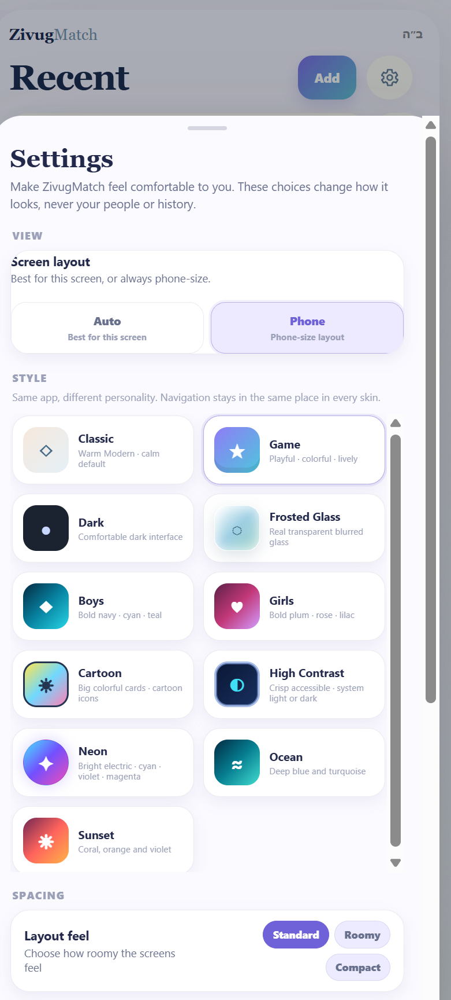

ZIVUGMATCH / ORIGINAL APPEARANCE REFERENCES

# TH-01 — Visual references only in this package

The existing ZivugMatch site has an appearance menu, including colors/skins and Compact, Standard and Roomy density modes. Those are future app-wide integration requirements, not functionality recreated in these HTML files. Preserve the original Claude Profile without recoloring or stylistic alterations.

## TH-02 — Appearance and density remain separate future settings

| **Setting**     | **Choices**                                                                                  | **Meaning**                                                                                          |
|-----------------|----------------------------------------------------------------------------------------------|------------------------------------------------------------------------------------------------------|
| Visual style    | Minimal / Claude-like; ZivugMatch / soft cards                                               | Flat, compact professional reading vs. warmer rounded, more spacious component styling.              |
| Density         | Compact; Standard; Roomy                                                                     | Adjust row heights, spacing, panel padding and information density; do not remove essential actions. |
| Skin / theme    | Classic, Game, Dark, Frosted Glass, Boys, Girls, Cartoon, High Contrast, Neon, Ocean, Sunset | Use the existing live-site skin names and semantics.                                                 |
| Contacts layout | Six user-switchable phone layouts retained from CT-13                                        | A separate presentation preference. No influence on themes or record content.                        |

## TH-03 — Original Game and Neon designs

Keep the user-provided original screenshots as the authority for Game and Neon. The settings screenshot lists Classic, Game, Dark, Frosted Glass, Boys, Girls, Cartoon, High Contrast, Neon, Ocean and Sunset. No new interpretations, recoloring, themes or CSS are approved here.

- Game and Neon are separate existing styles. Reproduce their actual appearance only after the user reviews the original screenshots and the main page designs are settled.

- Compact, Standard and Roomy are spacing choices, not separate data models. The compact Claude Profile layout is an approved visual reference, not an assistant-built replacement skin.

- The current final package intentionally contains no functioning theme playground. This chapter preserves only a requirement for possible later work and a screenshot of the original settings interface.

- A later unified appearance system, if built, should apply consistently across all pages without changing records, contacts, offers, profile content, notes, or history.

- A future implementation must preserve readable contrast, touch sizing, keyboard navigation, RTL support and reduced motion preferences.

- Any future theme or density preference must be saved independently of data and must not alter a person selection, conversation, filters or form values.

- No additional permanent theme toolbar is part of the present Contacts or Offers prototypes.

## TH-04 — No new appearance default selected

The supplied Claude My Profile remains in its original light appearance. Game and Neon are shown only as original screenshot references. A new unified theme implementation and its defaults have not been approved.

# TH-05 — Original screenshot reference

The image below is the user-supplied screenshot of the existing ZivugMatch settings menu. It is not an image of the assistant-created themes. Additional Neon and Game screenshots shared in the conversation are design references; this package does not recreate them.

Original settings screenshot: theme choices and Compact / Standard / Roomy density. Reference only; no interactive theme demo in this package.

## TH-06 — Later implementation checklist

- Finalize Home, My Profile, Contacts, saved person / Offers and formal Shidduchim page structure first. Any later appearance development must use original user references, not speculative theme recreations.

- When a real unified theme system is implemented, test at 320, 360, 390 and 430 px plus desktop for clipping, overflow and readability.

- Test a future appearance switch with an open person, long conversation, active filters, and unsaved notes; switching must not lose user data or context.

- Do not convey offer status through color alone. Preserve accessible controls and full Hebrew/right-to-left compatibility.

- No live theme settings or theme storage are implemented in this delivered prototype package.

## TH-07 — Package reference

| **File**                                                   | **Role**                                                                                                             |
|------------------------------------------------------------|----------------------------------------------------------------------------------------------------------------------|
| ZivugMatch_Master_Design_Specification_v10_2026-11-07.docx | Latest consolidated working master; preserves earlier approved chapters and adds PC and TH chapters.                 |
| ZivugMatch_My_Profile_Study_v10.html                       | Standalone Profile / Short versions / private Notes design study with working local interactions and theme controls. |
| ZivugMatch_Contacts_Offers_Study_v10.html                  | Standalone desktop Contacts study and six selectable phone layouts; includes new saved-person reading cards.         |
| ZivugMatch_Add_Person_Prototype_v3_0.html                  | Original Add Person intake reference; use fields and provenance, not a new database.                                 |
| Original screenshot references and HTML artboards          | Visual baseline for My Profile and Outlook Contacts; retained in companion ZIP.                                      |

Theme screenshots.html displays original screenshots only. It contains no color-switching controls. My Profile and Offers use Claude’s original warm light visual design.
