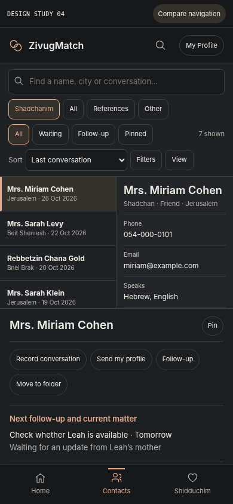
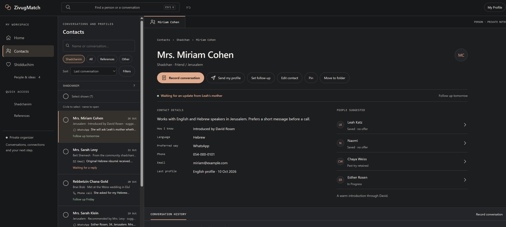
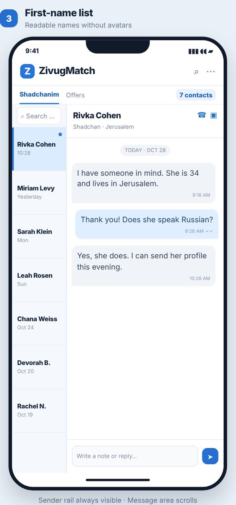
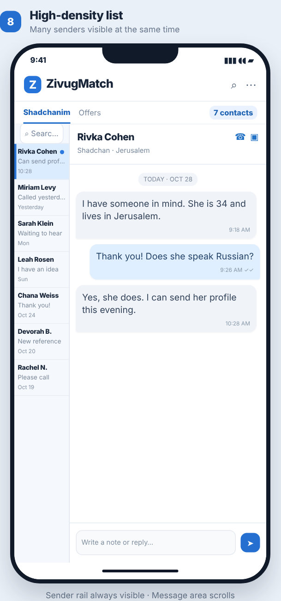

Design review addendum · 7 November 2026 · Version 8

This chapter extends the existing v7 master specification. It does not replace the approved Home v8, Shidduchim, Add Person, or Add Shadchan behavior. The companion index.html is an interactive study, not a deployed application.

# Decision register

| **Topic**             | **Decision / status**                                                                                                                                              |
|-----------------------|--------------------------------------------------------------------------------------------------------------------------------------------------------------------|
| Desktop Contacts      | Maintain the Outlook-style directory on the left and selected person details with conversations on the right. Established direction.                               |
| Phone Layout A        | Add as a selectable test layout: names top left; quick information top right; full-width activity below. Trial design, not final default.                          |
| Other phone layouts   | Preserve the previously available list, inbox, side-rail, top-strip options while comparative testing continues.                                                   |
| Pinning               | Provide Pin and Unpin; pinned contacts appear in a clearly labeled Pinned section at the top. Requested requirement.                                               |
| Folders               | Optional user-created folders; Move to folder and New folder. Empty accounts have no folders by default. Requested requirement.                                    |
| Sorting and filtering | Visible Sort and Filters controls above the directory. Filter contact role, city, language, community served, recorded activity and folder. Requested requirement. |
| Navigation grouping   | Compare three destinations with People & ideas inside Shidduchim against four destinations with People & ideas separate. Not finally decided.                      |

## CT-01 — Desktop Contacts baseline

- Preserve the familiar Outlook organization: left navigation, central contact directory, right-hand selected record, and visible recent conversations. Do not redesign the desktop merely to accommodate a phone.

- Shadchanim, references, friends and other helpers share one contact record. A person may have several roles simultaneously.

- A suggested person has one stable person record. A passing idea is not a formal offer and must never automatically start a dating process.

## CT-02 — Phone Layout A: top-left directory and top-right quick information

- The upper area is divided into two columns of approximately equal width on a phone. Left: independently scrollable shadchan directory. Right: independently scrollable quick information for the selected shadchan.

- The right side includes name, city, contact role, phone, email, spoken languages, communities served, preferred contact method when recorded, last recorded conversation, and brief current status. Missing fields show Not recorded.

- The entire lower portion of the screen belongs to the selected person: follow-ups, latest conversation, linked suggested people, full conversation history, and a quick note/composer action. Avoid duplicating the quick-info fields below.

- Tapping a different name updates both right-hand summary and lower activity, keeping the left directory and its scroll location. Finger movement started in the directory scrolls that list; movement in the quick-info panel scrolls its own contents. Elsewhere, the page scrolls normally.

- A 320 px phone must remain usable without horizontal overflow. At very small heights or large text, the selected summary can have independent scrolling rather than truncate essential contact information.

## CT-03 — Alternative phone layouts and settings

- The View control opens the existing layout chooser. Layout A is added as an option; the earlier One list, Names across the top, Inbox, and Names beside messages options stay available for comparison.

- The wider design study may also compare a vertically split layout with a draggable separator and a compact versus regular visual style. These are experiments, not mandatory changes to the live app.

- For the full app, a compact View and Organize area should hold layout and appearance choices. Search, Sort and Filters stay visible on the Contacts page and are not buried in Settings.

## CT-04 — Sorting, searching, and filters

- Search by saved name, city, known roles and relevant recorded conversation text; do not treat lack of recorded conversation as proof that the person has never been contacted outside the app.

- Sort choices: recent recorded conversation, oldest recorded conversation, name, city, language and community served. Missing activity sorts after dated records for the recent-first view.

- Filters may be combined: contact role, city, spoken language, community served, activity state (All, Waiting, Follow-up, Pinned), and optional folder. Provide Clear filters and visible selected-state indicators.

- Communities served is distinct from the shadchan’s own religious identity. Supported examples: Chabad, Haredi, Litvish, Bukharian, Sephardi, Breslev, Dati Leumi and user-created categories. A shadchan may work with several groups.

- Community, language and location values must be user supplied or otherwise genuinely recorded; never infer them from a person’s name or background. A filter with no matching contacts gives a clear empty state.

## CT-05 — Pinning

- Every contact can be pinned and unpinned. Pinned is a separate directory section at the top; its members retain ordinary sorting within the section.

- Pinning is organization only: it must not imply priority, activity or romantic interest. Changing pin state never duplicates a contact or its conversations.

- Pin/Unpin is accessible in the selected person view without requiring a new screen. The original contact remains searchable when unpinned.

## CT-06 — User-created folders

- No folders appear by default. A user may create a folder while moving a contact, choose an existing folder, or return the contact to No folder.

- Display folders only after they exist. Provide Move to folder on the selected contact. A contact moved to a folder remains in All contacts and other applicable filters.

- Folders must not be mistaken for separate person records or shidduch stages. The same conversation and references remain linked regardless of folder.

## CT-07 — Conversations, provenance and privacy

- Use the approved universal Home note model: one original note or activity item may appear in linked contexts without duplicate editable copies.

- Record a phone call, WhatsApp conversation, email, or personal note quickly. Communication type can be optional when unknown. A source-specific label means only what was actually recorded.

- Do not silently change Yes/No answers, create an offer, invent a person or infer a shadchan response from note text. Any consequential suggestion requires explicit confirmation.

- Send my profile must never include private conversation history, references, dating feedback or internal reasons. Opening a message composer is not confirmation that a message was sent.

## CT-08 — Mobile acceptance scenarios

- Choose Mrs. Cohen, scroll the directory 100 names lower, choose Mrs. Levy, and return without losing the directory location.

- Filter shadchanim by a city and multiple communities served; remove the filter without losing contact records.

- Sort by last recorded conversation and verify a contact without a recorded call is not falsely described as never contacted.

- Pin Mrs. Cohen; verify a labeled Pinned section; unpin and verify the normal sorted position returns.

- Create an optional folder, move a contact to it, filter by the folder and return to All contacts.

- Open the same conversation from a contact or linked saved person without creating two independent notes.

- Check 320, 360, 390 and 430 px widths; verify natural directory scrolling and no horizontal overflow.

- Switch to the previous phone views and desktop; ensure none of the approved flows are silently replaced.

## CT-09 — What the supplied HTML implements, and what remains future work

Implemented in the November 7 standalone index.html study: Layout A, prior phone views, role filters, a Sort selector, additional Filters, city/language/community options, Pin and Unpin, optional folder creation and assignment, and quick-info plus full-width activity. These operate on fictional sample data. Layout and some organization preferences can be retained locally in the browser for testing.

Not implemented or not validated for production: a real 200-contact persistent database, account synchronization, live Gmail/WhatsApp integrations, notifications, full folder management and shared backups, real telephone dialing permissions, verified data ingestion, or end-to-end accessibility evaluation. The approved Home and formal Shidduchim prototypes remain authoritative for their own workflows.

## CT-10 — Navigation comparison remains open

| **Arrangement**                                      | **Where People & ideas lives**                                                              | **Status**                   |
|------------------------------------------------------|---------------------------------------------------------------------------------------------|------------------------------|
| Joined: Home, Contacts, Shidduchim                   | A visible People & ideas view inside Shidduchim, separate from Offers / In Progress / Ended | Research starting preference |
| Separate: Home, Contacts, People & ideas, Shidduchim | An independently labeled destination with identical linked person records                   | Alternative to test          |

No person, offer, trial, history or shidduch may be duplicated or moved merely because the main navigation presentation changes.

# Layout A — phone visual reference

Screenshot captured from the standalone HTML at 390 px width with fictional sample contacts. The image is a test reference rather than proof of production readiness.

The upper-left directory and upper-right quick information scroll independently. The lower conversation history uses the available page width.

CONTACTS / DESKTOP VISUAL BASELINE

CT-11 \| Recovered Outlook-inspired appearance \| 7 November 2026

This page adds the actual Outlook-inspired desktop reference to the v8 Contacts chapter. The previous document described it but did not contain this screenshot. The reference does not replace the approved desktop experience or the still-experimental phone layouts.

# CT-11 — The three visible desktop areas

- Leading navigation: Home, Contacts, Shidduchim and access to People & Ideas, without turning ideas into formal offers.

- Central explorer: searchable and filterable list of named shadchanim, with the selected contact clearly highlighted; Pin and optional folders are organizational actions.

- Large right record: name, details and communications actions, current waiting/follow-up state, linked suggested people and chronological conversation history. Select another contact without leaving this workspace.

- Design principle: preserve the Outlook-style master/detail relationship. On the phone test layouts separately; do not squeeze the desktop columns into an unreadable narrow space.

## Outlook-style desktop screenshot (supplied by user)

Desktop Contacts screenshot. Design appearance reference, not a claim of production deployment. The actual conversation list continues below the visible record area.

Relationship to the phone experiments: v8 Layout A uses a scrollable directory at the upper left and quick information at the upper right, with conversations below; the alternate split-screen and other phone layouts remain comparative options.

# CT-12 — Narrow-sidebar phone contacts

Additional phone research reference. The left rail stays visible for switching people, while the selected person’s conversation or information uses the remaining width. This is a concept for comparison, not an approved replacement for the top-split Layout A, the vertically split layout or the desktop Outlook design.

- Left contact rail: names or concise previews, a selected-state highlight, independent vertical scrolling, and quick switching without returning to a separate list.

- Right reading area: selected shadchan, relevant actions, recent conversation and note entry; conversation scrolling should not inadvertently scroll the contact list.

- On phones, narrow rails trade readable contact identities for more message width. Test full names, first-name lists and high-density previews at 320, 360, 390 and 430 px.

- Preserve search, Sort, Filters, pinning, optional folders, and the joined/separate People & Ideas navigation choice regardless of the viewing layout.

- Examples below are taken from the ten two-pane mobile layouts comparison. These artboards show appearance and relative geometry, not proven interactive behavior or a production implementation.

<table>
<colgroup>
<col style="width: 50%" />
<col style="width: 50%" />
</colgroup>
<thead>
<tr class="header">
<th>

First-name list (concept 3)
</th>
<th>

High-density contact rail (concept 8)
</th>
</tr>
</thead>
<tbody>
</tbody>
</table>

Reference files: Mobile_Contacts_Two_Pane_Study/compare.html and Mobile_Contacts_Two_Pane_Study/ZivugMatch_10_Mobile_Two_Pane_Layouts.zip in the companion ZIP. The contact prototype itself remains separate from the full ZivugMatch application.

# CT-13 — User-selectable Contacts layouts

APPROVED FEATURE REQUIREMENT · Layout choice belongs to the user. The app should provide an ordinary, findable View control on Contacts, not a hidden study-only option. Choosing another layout must change presentation only; person data, shidduchim, conversation events, privacy boundaries and saved contact organization all remain shared.

## Layouts to make selectable on phones

| View                       | How it works                                                                                                                                         |
|----------------------------|------------------------------------------------------------------------------------------------------------------------------------------------------|
| A — Outlook summary at top | Independent contact directory at upper left and selected person quick facts at upper right; full-width conversation and activity below.              |
| B — Top/bottom split       | Scrollable contacts across the upper pane, full-width selected-person history below. Both panes scroll independently; user adjusts the split height. |
| Narrow left sidebar        | Compact persistent names on the left and selected conversation on the right. The name rail scrolls independently.                                    |
| Horizontal name tabs       | Names swipe left and right across the top; selected-person content occupies the full reading width.                                                  |
| Expanded list              | Contact list remains one column; selecting a person opens their details inline.                                                                      |
| Inbox-style drill-down     | Contact list, then selected person, then full conversation, with ordinary Back navigation.                                                           |

## View switcher behavior

- A small labeled “View” control belongs near Search, Sort and Filters on mobile Contacts. The selection panel lists each layout with a miniature structural preview, a short explanation, and a visible Current indicator. No large mode-switching toolbar is needed in normal use.

- Switch with one tap and immediately return to Contacts. Do not open a second people database or force a redesign of the other pages.

- Keep the same selected shadchan wherever the destination view supports an open selection; preserve active search, sort, city, language, community, folder, Pin and follow-up filters. Avoid discarding an unfinished note when changing a view.

- Remember the last chosen view on that device and restore it when Contacts reopens. Store this as a presentation preference, not as contact data. Production persistence across devices may be considered separately.

- The user must be free to change the view at any time; none of the six phone views is approved as the permanent default. Mobile selection is independent of the desktop Outlook-style Contacts arrangement.

- Maintain selection highlighting, readable names, keyboard and screen-reader labels, and right-to-left behavior when appropriate. Do not substitute symbols that resemble diagonal crosses or upright plus signs.

- Filtering/sorting, Pinned, optional folders, Record conversation, Send my profile, and the joined/separate People & Ideas navigation setting must be functional regardless of the selected layout. These are data and navigation features, not properties of a particular visual template.

- On 320, 360, 390 and 430 px screens, test selecting people, moving between modes, searching and restoring list position. Test long histories and 200 contacts. When two panes scroll, finger location must determine which region scrolls, with no accidental selection.

## Prototype and implementation status

The companion standalone Contacts prototype now offers all six views from its View picker, including the top/bottom split experiment with a saved height control. It uses fictional data and local browser storage for presentation settings. It does not replace the complete live ZivugMatch index or implement a production backend.

Status clarification: ability to switch views is an approved requirement. Individual views, their precise spacing and the default are still under review. The ten-layout comparison board is research; not all ten experimental artboards are promised as production view modes.
