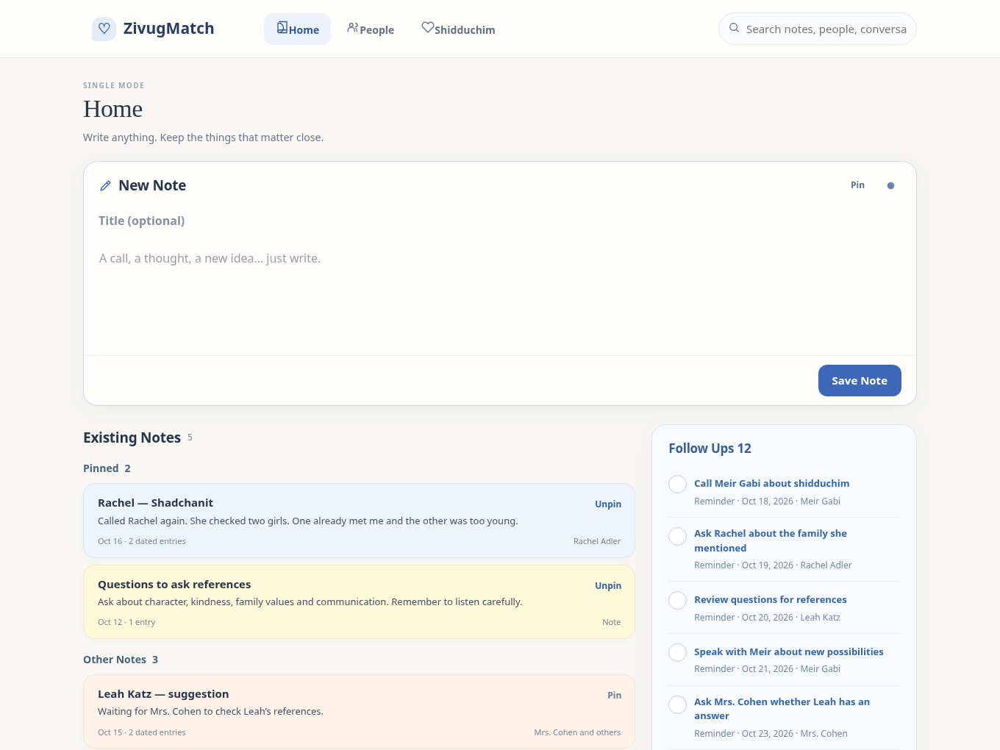

# HOME-01 — Single Mode Home / Note Intake

Design status: Home layout and note-entry interactions reviewed and refined through October 2026. Companion functional reference: ZivugMatch_Single_Mode_Home_Final_v8.html. This chapter is a prototype/UI specification—not a claim of deployed implementation or validated AI accuracy.

## Home — one page for writing and remembering

- Single Mode main navigation: Home, People, Shidduchim. Follow Ups and History are sections on Home, NOT separate main tabs.

- New Note spans the main content width at the top. On desktop, Existing Notes and History form the left column; Follow Ups occupies the right column. On phone, stack sections in one column: New Note → Existing Notes → Follow Ups → History.

- Keep a warm, uncluttered note-app feel. Avoid corporate dashboards, metrics, redundant icon blocks and mandatory intake forms. Search across all information remains easily accessible.

## HOME-02 — New Note editor

- Begin writing immediately. Title is optional; ordinary notes save without selecting a category, person, action or date. Store the original wording, creation time and subsequent dated updates.

- Visible editor actions (once writing begins): Actions, Link Contact, Follow Up, Save Note. No dropdown arrow symbols next to Actions or Link Contact. Pin / Unpin is a separate, always-visible, small plain-text toggle in the note header, not a large badge or a footer button.

- Suggestions On/Off is a very small dot in the note header: blue when enabled, grey when disabled; hover tooltip and accessible label explain the control. It must not occupy a long toolbar space.

- While typing, recognized people, possible new contacts, relevant answer phrases and time phrases may receive subtle inline highlighting. Show up to three compact, optional suggestions; never interrupt capture with a mandatory review.

- One tiny blue, rounded Star of David (approximately 12 × 14 px) appears beside the Suggestions heading only; none beside individual suggestion rows. Do not substitute sparkle graphics.

## HOME-03 — Notes, pinning and color

- Existing Notes has two groups: Pinned first, Other Notes below. Notes can be unlinked, linked to one person or linked to several people; linking must not create duplicate editable notes.

- Pin and Unpin are the two states of ONE control. The small plain-text control is always visible on an existing note, including when expanded; clicking it must never accidentally enter the writing field.

- Note colors are MANUAL, not auto-assigned from the contents. Default paper/cream plus five subtle optional colors: Blue, Yellow, Peach, Green, Lilac. Choosing a color changes the whole note, not just an update.

- Change Color belongs inside the small Actions dropdown, not a separate prominent control or screen. Provide six circular, individually named color swatches (Default, Blue, Yellow, Peach, Green, Lilac) and show the currently selected swatch. For a NEW note, selecting a color prepares the new note and it is stored on Save; for an EXISTING note, apply the chosen color directly and record that change in History.

## HOME-04 — Actions and Link Contact dropdowns

- Actions is a compact dropdown beneath its button (desktop and phone): detailed Follow Up settings (optional due date/description), Add to an Existing Note when starting from New Note, Waiting for Someone, Create Contact, and the integrated Change Color swatches. Do not force these advanced settings during ordinary entry.

- Link Contact is another compact dropdown: quick search, selection of more than one existing person, and Create New Contact. Recognized unique names can be suggested before Save; ambiguous names must not be silently assigned.

- Follow Up is a one-click action that queues the item when the note is saved, with NO date selection required. If the note already says “call back in 2 weeks”, use that date automatically. Actions → Follow Up Details is available for editing time or description. Never ask again for an unambiguous date already typed.

## HOME-05 — Add to an Existing Note inline

- A note is a continuously editable, dated record. Appending new material NEVER overwrites the earlier entries. Automatically insert a thin date/time divider and append the new words below the prior updates; the new event appears in History and relevant people histories.

- On desktop, clicking the body of an existing note expands an update writing area on Home and focuses it. On a touch phone, swiping or tapping the card body must NOT open the editor; show a small “Add to note” text link as the deliberate action. The update stays on Home—do not navigate to a separate editing page.

- When the user begins typing an inline update, display the compact note actions and any relevant Smart Suggestions. The existing note’s linked people are already known; do not request those links again unless the new text mentions others.

- From New Note, when a person has an unambiguous related existing note, Smart Suggestions may offer “Add dated update to Rachel’s note” in one click. When multiple notes match, let the user pick the correct note; never silently merge unrelated notes.

## HOME-06 — Follow Ups, on the Home page

- Follow Ups is a right-hand desktop column with distinct but restrained styling: muted blue titles and/or a very faint tinted background. On phones it stacks beneath Existing Notes. The group includes the user’s tasks and items waiting on other people.

- Show the first TEN open items. Put “See all” at the BOTTOM; it expands the remaining items right there on Home and becomes “Show less.” No separate Follow Ups navigation destination.

- The completion circle on each Follow Up is an explicit click target. On desktop, hovering over its row makes a checkmark appear inside that circle so the action is obvious. Include keyboard-focus feedback. Completing a Follow Up keeps the underlying note/history intact.

## HOME-07 — History, on the Home page

- History automatically records meaningful app activity—new notes, dated updates, linked contact/answer changes, reminders and completed Follow Ups. One dated original event can be displayed in multiple linked contexts without copying its source information.

- History is intentionally text-forward and visually quieter than Follow Ups. Show the latest FIVE entries; place “See all” at the BOTTOM to expand inline, then “Show less.” Do not use a separate History tab.

- Each History row has a small chevron on its right, not repeated “Open” text. Only that specific tap target expands the row on Home, showing the complete entry and any related-note shortcut. Touch swiping/scrolling over the row must not trigger opening.

## HOME-08 — Safety, information processing and implementation boundaries

- Save the original text reliably before depending on optional classification or AI. Smart Suggestions may use simple offline rules first; the attached v8 HTML is a rules-based demo, not real AI. Disabled suggestions never prevent saving or manual actions.

- Suggested Yes/No answers, match endings and other consequential status changes require explicit approval. Preserve who reported information, distinguish one person’s answer from another’s, and never invent an unnamed girl/profile or shadchan response.

- Search should cover notes, person names and contacts, time-stamped updates, Follow Ups and meaningful record-change History. Revisions and app-generated actions should remain attributable to their source note or person.

- Prototype stores fictional sample information in browser localStorage only; it has no account synchronization, real notifications, production backend or evaluated language model. People and Shidduchim destinations in the Home prototype are lightweight previews, NOT replacements for the separately approved screens in the earlier chapters.

## HOME-09 — Acceptance walkthrough / practical tests

| Scenario                                       | Expected Home behavior                                                                |
|------------------------------------------------|---------------------------------------------------------------------------------------|
| Write “Spoke to Rachel”                        | Suggest linking Rachel; save words even if suggestion ignored                         |
| Write “Call Rachel back in two weeks”          | Suggest one-tap Follow Up using the recognized date; no date picker                   |
| Write “Jim has ideas”                          | Offer to link a real Jim or create a minimal new contact; do not fabricate a phone    |
| Write “Called Rachel again”                    | Offer dated Add to Rachel’s existing note, only if the note match is clear            |
| Write “Mrs. Cohen says Leah is not interested” | Preserve original report; require confirmation to change Leah’s answer / end an offer |
| Open a note and write again                    | Inline dated update on Home; desktop card click, mobile “Add to note” link            |
| Change an existing note’s color                | Actions → choose a swatch; note changes immediately and History records the change    |
| Browse long Follow Ups / History               | Ten and five initial rows respectively; See all expands inline; no new page           |

Design reference screenshot below. The screenshot is an illustration of the browser prototype and not proof of production persistence or deployed functionality.

Home v8: New Note above Pinned / Other Notes, Follow Ups on the right, History on Home. The color menu is integrated into Actions.

Version history: v6 captured Shidduchim and Add Person design decisions; v7 adds reviewed Single Mode Home behavior and the integrated note color palette. The live app remains unchanged.

CONTACTS / SHADCHANIM

Mobile layouts, organization controls, and navigation choices
