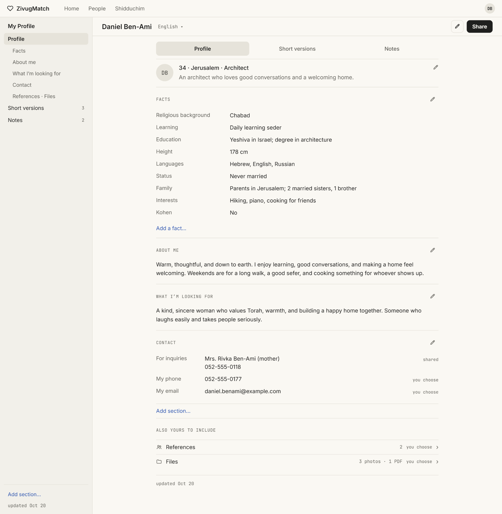
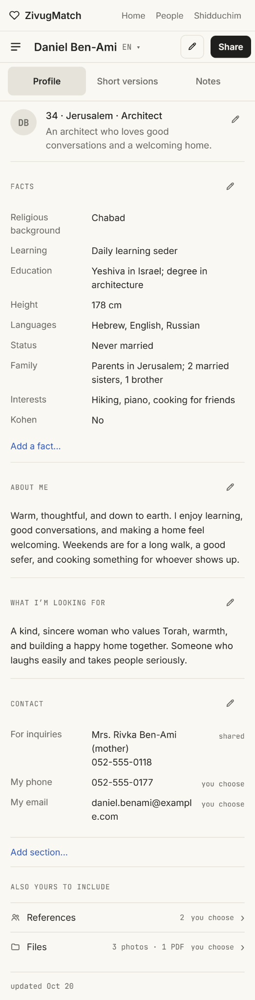
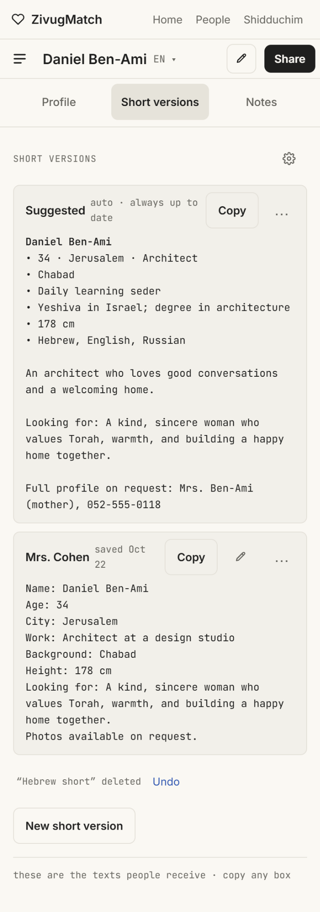
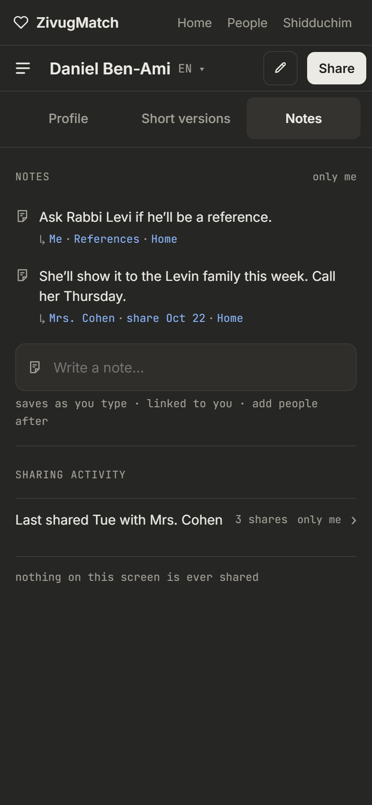

MY PROFILE / DESIGN REFERENCE

MP-01 to MP-09 \| New master chapter \| 7 November 2026

Source status: the supplied desktop and phone screenshots and their HTML exports are visual design references. Their sample identity, facts, phone numbers and messages are demonstration content. The HTML ZIP files explicitly describe the screens as mockups, not production functionality.

# MP-01 — My Profile: purpose and navigation

- My Profile is the owner’s shareable personal profile, separate from other people’s records and from private contact notes or shidduch histories.

- The visible three tabs are Profile, Short versions and Notes. They are views of the same owner identity, not different copies of the person.

- The header shows the owner’s name, an EN/language selector, an edit action and a prominent Share action. The desktop uses a left-side subsection navigator; the phone uses stacked, full-width content.

- The screenshots use a restrained, warm light appearance for Profile and Short versions; a dark appearance is also shown for Notes. Treat these as supported visual directions, not proof that theme-switching has been implemented.

# MP-02 — Profile tab: the supplied structure

- Top identity summary: name, age, location and occupation, followed by a brief introduction. Each substantial section has a small edit pencil rather than a large editing control panel.

- Facts: religious background, learning, education, height, languages, marital status, family, interests and Kohen are examples in the supplied screenshot, not an exhaustive or mandatory fixed schema. “Add a fact” permits user-defined facts.

- About me and What I’m looking for remain readable free-text sections. “Add section” suggests user-created profile content.

- Contact distinguishes a contact for inquiries from the owner’s own phone and email. The screenshot explicitly distinguishes “shared” from “you choose”; never assume a personal phone or email should be sent by default.

- References and Files appear under an optional “Also yours to include” area; the screenshot indicates that the owner chooses whether to include those items. Do not silently attach files or confidential references.

# MP-03 — Desktop and phone reading behavior

- Desktop: a narrow left navigator offers shortcuts into Facts, About me, What I’m looking for, Contact, References and Files, plus the other tabs. Main content is centered and text-led rather than stretched to full monitor width.

- Phone: the same sections appear in one column with generous readable text, light dividers, and accessible editing targets. The phone tab bar offers Profile, Short versions, Notes.

- Preserve the selected language, section and tab when editing; avoid losing drafts or unintentionally sharing the result. Exact save and navigation mechanics still require production decisions.

# MP-04 — Outgoing sharing and provenance

- The Share control needs a preview of exactly which text, facts and optional attachments will be sent, and to which recipient. Full and short presentations must reuse the underlying owner profile data.

- A share should not include the private Notes tab, contact histories, references or files unless the user explicitly chooses allowed outgoing material. References shown on a profile can be separate from confidential reference-call notes.

- A Copy action copies text but is not a confirmed send. Opening WhatsApp or email does not prove that the recipient received anything. Save immutable sent snapshots and source/time when a send is explicitly confirmed.

## Source-supported status register

| **Item**                         | **What the supplied source shows**                    | **Status in this specification**              |
|----------------------------------|-------------------------------------------------------|-----------------------------------------------|
| Profile / Short versions / Notes | Three named tabs, consistent person header            | Visual design reference                       |
| Language selector                | EN and language-change affordance                     | Visual design reference; behavior unverified  |
| Share, Edit, Copy                | Visible controls in mockups                           | Workflow needs implementation/validation      |
| Private notes                    | “only me” and “nothing on this screen is ever shared” | Strong privacy design intention               |
| Automatic saving                 | Notes mockup says “saves as you type”                 | Visual copy; persistence mechanics unverified |

# MP-05 — Full Profile: desktop visual

The desktop reference uses a left navigation rail and centered reading column. The top row keeps the name, language and Share accessible, while each information section can be edited separately.

Supplied desktop Profile artboard. The rendered screenshot is a reference; the accompanying HTML export is not production code.

# MP-06 — Full Profile: phone visual

The mobile screenshot preserves the same information hierarchy without retaining the desktop left sidebar. It shows the identity summary, Facts, About me, What I’m looking for, Contact, and References/Files.

Supplied phone Profile screenshot; full-resolution source is included in the companion reference package.

# MP-07 — Short versions: sendable text representations

- The Short versions tab shows at least two kinds of text in the sample: a “Suggested” version described as automatic and always up to date, and a saved recipient-specific version labeled “Mrs. Cohen.”

- Each visible card includes Copy. A menu and edit affordances appear for saved versions. The screenshot also shows “New short version” and an Undo option after a deletion.

- Keep manually saved versions separate from the generated Suggested text. The visual does not establish whether saved versions should update when the owner profile changes; preserve historical sent snapshots either way.

- The exact template settings, which facts are included, language-by-language generation and whether contact-specific versions can be automatically regenerated are open implementation choices.

Supplied phone Short versions screenshot. “Suggested” and “Mrs. Cohen” are sample version titles and text, not real outgoing messages.

# MP-08 — Private Notes and sharing activity

- The dark phone design shows the Notes tab labeled “only me.” Example notes include a potential reference and a later contact follow-up, with links to other contexts such as References and Home.

- A visible “Write a note...” composer is labeled “saves as you type · linked to you · add people after.” This represents the intended low-friction capture experience; autosave timing and durable storage are not demonstrated by the mockup.

- A separate Sharing Activity area records a previously shared version and the number of shares. Sharing activity is metadata, not a reason to expose notes.

- The explicit privacy boundary shown is “nothing on this screen is ever shared.” Maintain that boundary across Share and Short versions and preserve one underlying note across linked contexts.

Supplied dark Notes phone screenshot. No corresponding Notes HTML export was supplied in this set.

# MP-09 — Source files and outstanding decisions

The original screenshot and HTML ZIP exports are included in the companion archive. They should be retained beside the master specification so a developer can reproduce styling accurately without treating visual mockups as application code.

| **Source**                                      | **Role**                                         |
|-------------------------------------------------|--------------------------------------------------|
| image(7).png                                    | Outlook-inspired desktop Contacts appearance     |
| Three screens · desktop · Profile@2x.png        | Desktop Profile layout and information hierarchy |
| Three screens · phone · Profile@2x.png          | Phone Profile layout and editable sections       |
| Three screens · phone · Short versions@2x.png   | Short versions, Copy, New, Undo, Suggested       |
| Three screens · phone · Notes (dark)@2x.png     | Private Notes and Sharing Activity visual        |
| Three screens · desktop · Profile-html.zip      | Desktop Profile exported visual artboard         |
| Three screens · phone · Profile-html.zip        | Phone Profile exported visual artboard           |
| Three screens · phone · Short versions-html.zip | Phone Short versions exported visual artboard    |

## Still to review before treating My Profile as fully approved

- Share dialog: recipient choice, channel choice, attachment/reference inclusion, exact snapshot and confirmation of delivery status.

- Language selection and translation: what is manually translated, generated, or independently saved by language.

- Short version management: whether saved versions are frozen or editable templates, default generation rules, deletion and Undo persistence.

- Notes: true autosave behavior, recovery, related-person linking, and consistency with the approved Home v8 note system.

- Privacy: separate own-contact details, inquiries contact, selected references and optional files; never expose private histories.

- Theme consistency: warm light My Profile, optional dark Notes, and the desktop Contacts dark workspace are separate visual references until a shared theme strategy is chosen.

- Exact UI response of visual-export buttons, whose presence alone does not prove operational behavior.

## Version-control note

This v9 specification appends desktop Contacts visual evidence and the My Profile design chapter to v8. It does not deploy the live site, modify the existing application index.html, replace prior approved Shidduchim/Add Person/Home decisions, or approve any untested My Profile functionality automatically.
