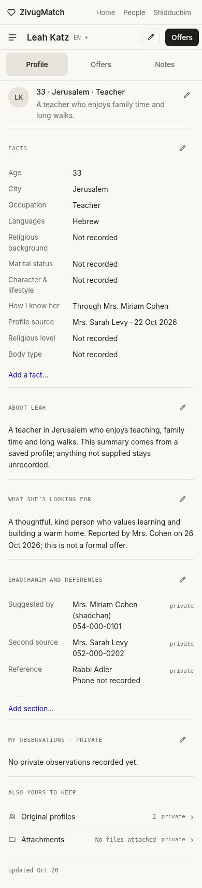
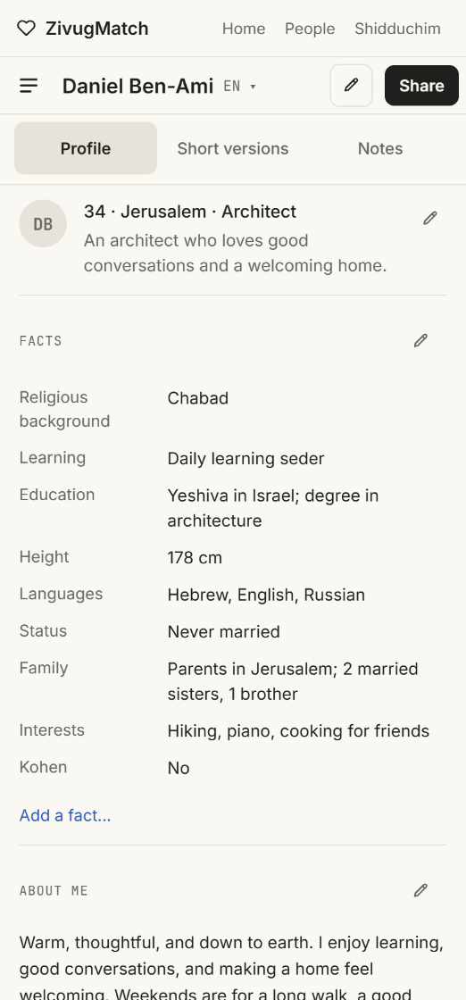
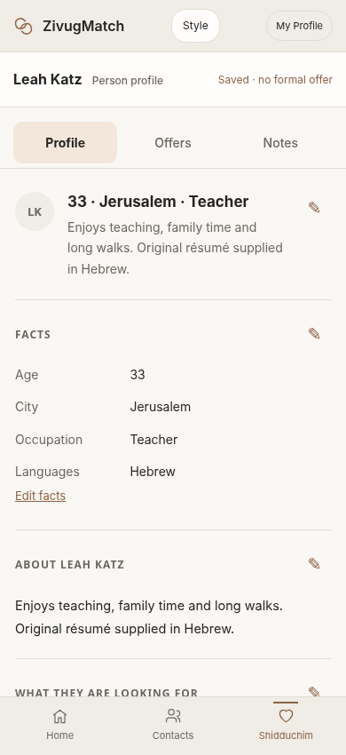
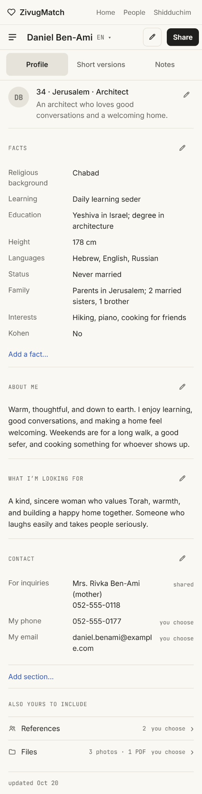
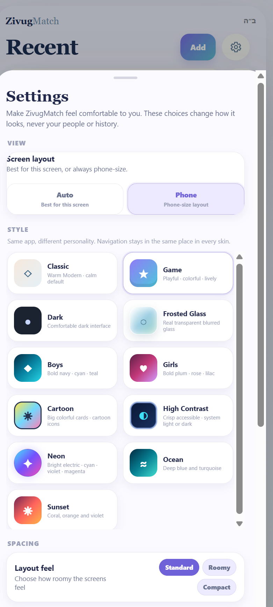

ZIVUGMATCH / SAVED PERSON CARDS

# PC-01 — People & Ideas / Offers reading card

NEW DESIGN REQUIREMENT · The saved-person card should read like My Profile, using the fields and source records already defined by the approved Add Person v3.0 intake. The approved formal Shidduchim experience remains a separate linked process. This is not a request to replace all offer progress bars with the card.

- Identity at top: name, available age, city and occupation, with compact Edit person, Add note and Follow-up actions. Show no fabricated field when information is missing.

- Reading sections: Facts; About the person; What they are looking for; Contacts and Source; original résumé and attachments. Use the same airy text, dividers and section-level organization as My Profile.

- Fields originate in the approved Add Person sections: About and Looking For, Personal Info, Contacts and Source, How well do I know them, Status, Religious, Character and Lifestyle, and Attached items. Hidden or custom fields keep their existing saved values.

- Display contact ownership correctly. A number supplied by a mother, father, reference or shadchan is not a direct number for the proposed person. Preserve original profile text and versions unchanged.

- Interest and Offers is a separate reading tab or section: My interest, the other person’s reported response, who reported it, private reasons and dated revisions. No automatic creation or ending of an offer from a note.

- A formal offer, active try or ended try is linked to the preserved Shidduchim record. The card may show a short status and open that record, but must not duplicate or independently edit formal dates, answers or stage history.

- The person record remains unique even when several shadchanim suggest the same person. Each source retains its relationship. Suggested-person cards must be findable through the source shadchan and People and Ideas search.

- On mobile, show a single readable profile column; on desktop, reuse the original Claude My Profile structure. New skin treatments are not part of the current HTML prototypes.

# PC-02 — Prototype behavior and scope

Companion file: Shadchanim Offers.html. This is a standalone saved-person / Offers card derived from the exact original Claude Profile HTML and Add Person v3.0 fields. Its tabs are Profile, Offers and Notes, and it does not replace the live Shidduchim, Contacts or Home application. The Contacts layout experiment is a separate file.

## User interface preview — saved person

Corrected prototype: Claude Profile page structure with saved Add Person facts, and separate Offers and Notes tabs. Fictional example.

# FINAL-04 — Offers profile: visual match to My Profile

Confirmed design direction · 7 November 2026

The saved person / Offers card is a person profile, not a second CRM interface. It must have the same visual arrangement as My Profile.html. The content comes from the existing Add Person prototype and its underlying record; the current prototype uses fictional examples.

- Use the same narrow reading column, compact name bar, three equal profile tabs, avatar and summary row, section dividers, label/value facts grid, and restrained inline edit controls as My Profile.

- Tabs are Profile, Offers, and Notes. The top-level Profile tab reads like My Profile, whereas Offers holds relationship decisions and formal offer links, and Notes holds private observations and conversations.

- Populate facts and sections from ZivugMatch_Add_Person_Prototype_v3_0: name, age, city, occupation, languages, religious level and background, family status, character and lifestyle, body type, familiarity, description, what the person is looking for, contacts, references, sources, originals and attachments.

- Show only recorded facts and preserve missing values as unknown. Never infer a private attribute from the name, city, shadchan or community served.

- Editing should open the existing three-tab Add Person intake (Paste, Basic Info, Detailed Info), preserving originals and source attribution. Use the same underlying person record across Contacts, People and Ideas, and formal Shidduchim.

- Offers distinguishes preliminary interest from a formal offer. A saved person must never enter the formal stages automatically; previous attempts, ending reasons and date history remain intact.

- Keep private impressions, notes, interest reasons and conversation history separate from outgoing My Profile content. Themes and density are presentation preferences only.

- The desktop Outlook-style Contacts interface is preserved independently; it is not the visual template for the Offers person card.

## Visual references — same structure, different person data

Left: supplied My Profile reference. Right: updated Offers profile using fields from Add Person. Both use the same restrained reading layout; the Offers page has its own tabs for preliminary interest and private notes.

| **My Profile · reference**                                                                                                                                     | **Offers / saved person · updated**                                                                                                                            |
|----------------------------------------------------------------------------------------------------------------------------------------------------------------|----------------------------------------------------------------------------------------------------------------------------------------------------------------|
|  |  |

# FINAL-05 — Source of truth: original Claude My Profile

Design correction and approved source priority · 7 November 2026

The exact user-provided Claude Profile HTML exports are the visual source of truth. Earlier assistant-built My Profile.html designs were an unintended redesign and must not be treated as the approved reference. Retain the supplied Profile phone, Profile desktop and Short versions artboards together with their support.js and vendor files. The dark Notes screenshot is an additional design reference, not a replacement for the approved light Profile artboard.

## Offers person card — copy the Claude profile language

- Use the same white/ivory background, subdued grey section dividers, narrow facts rows, typography, name bar, compact three-tab navigation, inline edit pencils and reading rhythm as the original Claude Profile export.

- The person card has Profile, Offers and Notes tabs. Profile is the same visual template as My Profile, but reads saved Add Person fields; Offers contains my interest, her reported response, formal-offer status and any past tries; Notes contains private recorded contacts, conversation entries and reminders.

- Use the single existing Add Person person record and retain sources, pasted originals, attachments, contacts and references. Unknown fields remain Not recorded, not inferred or filled automatically.

- The prototype supplies a fictional person to demonstrate field mapping. A saved person or suggested idea does not become a formal offer automatically.

- The user’s Claude HTML is preserved byte-for-byte; the companion Shadchanim Offers.html is a derived mockup. Editing in the full app should invoke the approved Add Person form rather than maintain a second data model.

## Appearance — screenshots only at this stage

Remove all assistant-created theme demonstrations from this package. Retain only the screenshot of the user’s existing ZivugMatch appearance menu, which shows their available skins and the Compact / Standard / Roomy density modes. This image documents a later integration requirement; do not claim that any reproduced skins or theme controls are implemented in these prototype HTML files. Do not recolor or restyle the original Claude My Profile to demonstrate themes.

## Correction visual reference — supplied Claude source

The screenshot below is from the original Claude design. It is the required look and visual hierarchy for Offers person cards, with the content swapped to Add Person data.

Theme appearance is referenced only by the user-supplied screenshot below, not by a new design.

