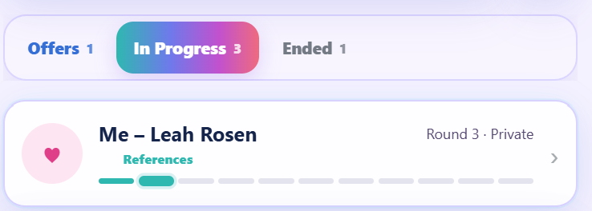
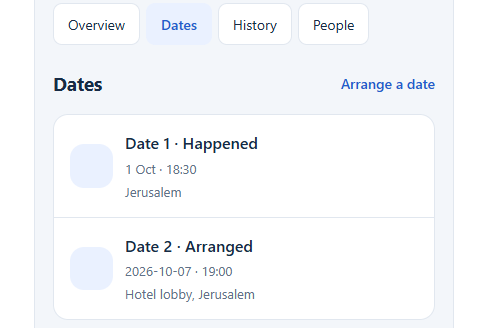
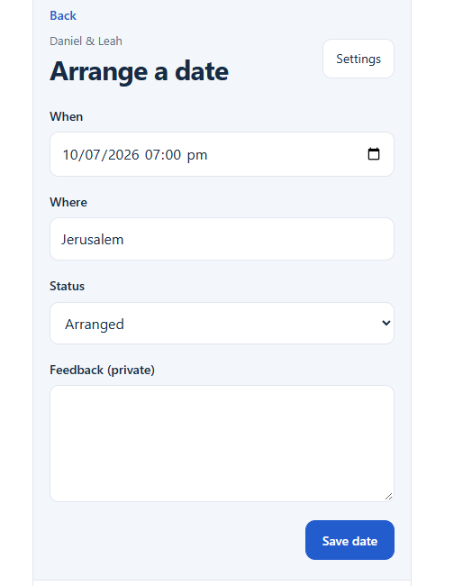
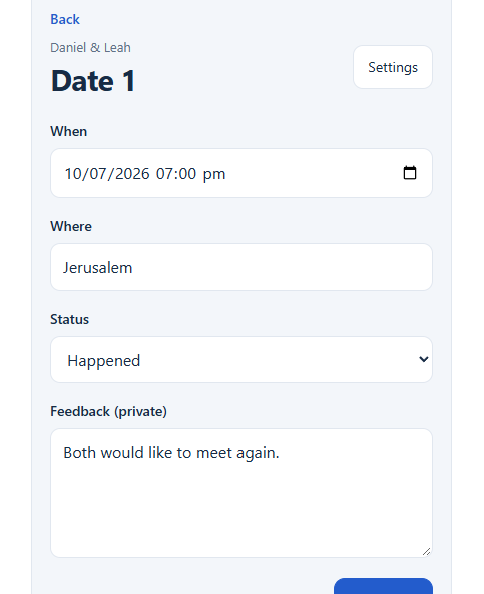
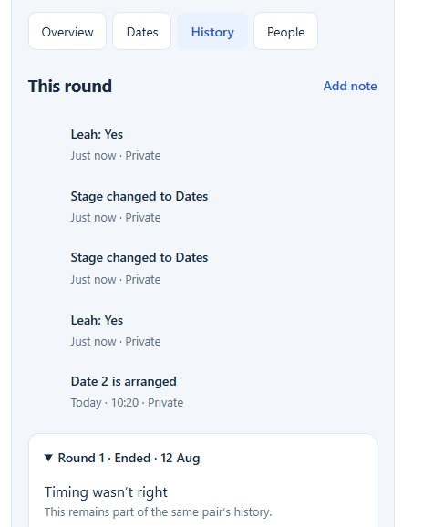

Shidduchim — Design Review

ZivugMatch \| Consolidated decisions for the prototype \| Version 1

Version 10 \| Preserves earlier reviewed chapters; adds Profile-style person cards and shared appearance requirements, 7 November 2026.

Purpose This opening Shidduchim review is retained as the historical baseline. Later chapters document Add Person, Home, Contacts, My Profile, person cards and shared appearance.

**Status** Design approved in conversation; not a claim that the app has been coded or tested.

# Quick function list

- SH-01 Shidduchim tab — Offers / In Progress / Ended, Compact and Expanded cards, inline answer bubbles, quick update and milestone bars. REVIEWED

- SH-02 Shidduch Overview — person details, answers, progress, shadchan, notes. REVIEWED

- SH-03 Dates — view dates, arrange a date, edit a date, record feedback. REVIEWED

- SH-04 History — automatic activity history, past tries, quick notes. REVIEWED

- SH-05 Make Match — create a new pairing. NOT DESIGNED YET

# Key rules — quick glance

- Both sides say Yes → move from Offers to In Progress.

- Either side says No → move to Ended. Thinking during dating stays In Progress.

- The bar has 11 segments: Offer / first milestone (label still to confirm), References, Dates 1–8, Marriage.

- Date segments fill only when that date is marked Happened. Skipped References stays gray.

- The bar stops at Date 8, but Date 9, 10, etc. continue in the date records.

- Ended preserves who ended it, optional reason, and a grayed snapshot of that try’s progress.

- Try Again is offered only after Ended; previous attempts remain, called 1st Try / 2nd Try / 3rd Try.

- No separate Pause button and no automatic meeting-confirmation tasks.

# What must not be assumed

- Make Match is a future design task; do not invent its form or workflow.

- The exact definition/name of progress segment 1 still needs confirmation.

- Automatic change of a past arranged date to Happened was not approved; do not implement it by assumption.

- “Three tries total” is provisional; confirm before enforcing a hard limit.

This document intentionally records approved decisions plus explicit open items. It does not replace the older architecture research; the relevant shared-data rules are summarized on the last page.

# SH-01 — Shidduchim main tab

**Layout** Three tabs in this order: Offers → In Progress → Ended. A top-right button says “Make Match” (never just “Add”).

**Sorting** Offers: recently updated first. In Progress: recently updated first. Ended: most recently ended first.

Cards Rounded cards with names, segmented progress bars, and a Compact / Expanded switch. Compact is the default; Expanded offers quick actions on the list without replacing or duplicating the existing Details page. Preserve the cheerful teal-to-pink tab treatment from the visual reference.

Reference A — Original tab appearance and In Progress card; retain the selected-tab gradient.

## Milestone bar — 11 positions

- 1: Offer / initial step (exact label needs confirmation; an offer should visibly begin the bar).

- 2: References, if either side actually checked references. If skipped, leave gray even after dates begin.

- 3–10: Date 1 through Date 8. Fill only each date marked Happened; arranged/cancelled stays gray.

- 11: Marriage. After Date 4, use a stronger color change for later dates.

- More than eight dates: the visible bar stops filling after Date 8, but the actual date number keeps increasing.

Color direction (provisionally approved): teal \#28B6AD for early steps; purple \#826CEB for Dates 1–4; pink-purple \#B85AC4 for Dates 5–8; gold \#D0A041 for marriage; light gray \#E1E3EC for not completed. These are design colors, not status logic.

## Category rules

- Offers: remain here while at least one side has not said Yes, including while checking references.

- In Progress: enter only when BOTH sides have said Yes. Choosing Thinking after dating has already begun does not erase dating progress or automatically return the shidduch to Offers.

- Ended: move here when EITHER side says No, after confirmation. On the list show both answer bubbles followed by one simple “Ended” label; do not repeat “Ended by \[name\]” because the colored answer already shows who said No. Preserve the ending source and optional reason in Details and History.

- Ended card retains the progress reached. Previous completed steps appear as darker gray; unfinished steps lighter gray.

## SH-01 — Compact and Expanded cards (approved design update)

- Compact is the default. Expanded is an optional larger card mode. Both show the same underlying match and current try; changing modes must not create duplicate records.

- Compact before both Yes: show two rounded, softly colored answer bubbles directly below the couple’s names, above the progress bar. Do not repeat the old waiting/status explanation beside them.

- Each Compact answer bubble is one clickable, oval, color-coded button showing the person’s name and current answer. Do not show up/down arrows, chevrons, or dropdown indicators inside the bubble. Tapping anywhere on it opens a small custom floating panel with four rounded choices in this order: Not answered yet / Yes / Thinking / No. Do not use the operating system’s rectangular select dropdown. After selection the panel closes and the bubble updates; the unanswered state reads “Waiting” (never “Undecided”).

- Answer colors: Yes = soft green; No = soft peach; Thinking = soft yellow; Waiting (not answered yet) = neutral pale gray. Name and answer remain readable together.

- Once both have Yes on an active match, hide the two Compact answer bubbles and restore the original simple stage / next-date information and unchanged 11-segment progress bar.

- Compact in Ended: retain the two colored answer bubbles, then show only the label “Ended” after them; omit duplicate Ended badges and “Ended by \[person\]” prose on the list. Keep provenance and reason in Details and History.

- Expanded shows direct one-tap Stage choices (Checking / Dating / Ended), direct one-tap answer choices (Yes / No / Thinking) for each person, “Add update”, and “Open details”. Do not show a second colored answer summary that duplicates the editable choices.

- “Add update” on the Expanded list card opens a short inline writing area. Saving appends one dated and timed item to the current try’s existing History (also visible in Overview Recent history), not a separate duplicate note.

- Consequential actions: selecting No asks for confirmation before ending a match; recording a reason and reporter is optional. Selecting Ended explicitly also asks for confirmation. Undo is offered for quick list changes.

- Moving from Checking to Dating requires both Yes answers. A later Thinking after dating has started leaves the match In Progress; previously completed dates and history remain intact. “Not answered yet” clears an unreported answer without deleting past events.

- Ended tries preserve historical answers. Their Compact bubbles retain the same appearance (no arrow) and may open a read-only floating panel, but changing an ended try must not silently rewrite its history; use Try Again from Details to begin a new attempt. Any future historical correction workflow requires separate approval.

- Keep the existing Overview, Dates, History, Try Again rules and visuals. The new direct controls are on the main list only; avoid duplicating this control panel inside the details screen.

- On narrow mobile screens the answer bubbles wrap when needed; the floating choice panel remains visible and tappable without covering its own controls or requiring horizontal page scrolling. Tap outside or press Escape to close the panel; keep keyboard focus and accessibility labels for the arrow-free clickable bubbles.

# SH-02 — Shidduch details / Overview

**Navigation** Three tabs only: Overview, Dates, History. Remove People because it duplicates person records.

**Top** Keep a small Back control and the same 11-segment bar. Remove the large duplicate couple title and the old five-step progress text.

**Opening summary** Use a short heading such as “Dating”, followed by “Next: Date 2” and a friendly date/time if arranged. Avoid “Getting to know each other” and “Round 2”.

## Two person cards

- Show two cards side by side: first name on line 1, surname on line 2, in larger readable type.

- Each card shows age, city and occupation; tapping the name opens the existing person profile.

- Each card has its own Answer dropdown: Yes / Thinking / No. No separate “Update Status” button.

- Keep the display uncluttered. Reporting source (“Who told you?”) can be requested only when an answer changes; exact save interaction remains to be settled.

## Under the person cards

- Show one compact “Shadchan: Miriam Cohen” line. Tapping the name opens that shadchan’s profile.

- Remove the duplicate blue Next date box: the next date is already shown above.

- Remove “Confirm tomorrow’s meeting” and related auto-generated confirmation tasks.

- Remove the Pause button; Thinking covers a break without closing or resetting the match.

- Keep Recent history at bottom: 3 recent items, date AND time of change, “Add note” text button, plus a way to see all history.

## When answers change

- No: the match moves to Ended, showing who ended it and optional reason. Past activity stays saved.

- Thinking after dating started: remains In Progress; changing back to Yes continues with the next date number.

- In Ended only: offer a “Try Again” action, subject to the tries limit; nothing resets just because someone chose Thinking.

# SH-02 continued — Trying again

**Terminology** Never show technical “Round 1 / Round 2”. Use “1st Try”, “2nd Try”, and “3rd Try”.

- “Try Again” appears only after a match has moved to Ended, and not while it is active or an open offer.

- Same couple, same underlying match record. Do not create a duplicate shidduch.

- Keep the previous try’s progress bar underneath the current one; all its filled steps turn shades of gray to show how far it got.

- Start a fresh colored bar for the new try. Dates are numbered afresh for that try, starting with Date 1.

- Keep previous tries’ dates, ending reason and history. Both old and current bars remain visible on Details.

- Proposed maximum is 3 total tries; this remains provisional, not a final business rule.

# SH-03 — Dates tab

**Layout** Keep the Astra design with a Dates list and “Arrange a date” at top right. List dates in order and show Date number, status, date/time and place.

**Display** Use friendly dates, e.g. “Oct 7 · 7:00 PM”, instead of raw 2026-10-07 / 19:00 formatting.

Reference D — Approved Dates list appearance.

## Statuses and progress

- Arranged: planned; its progress-bar segment stays gray.

- Happened: this date’s segment fills in the bar and appears in history.

- Cancelled: the date remains in history but does not color a progress segment.

- Dates 9 and later remain in the list with their real date numbers, even though the visible bar only has eight date positions.

# SH-03 continued — Arrange or edit a date

**Form** Keep the simple Astra form for new dates and existing dates, with the same fields and Save date button.

- When — date and time picker.

- Where — meeting location.

- Status — Arranged / Happened / Cancelled.

- Feedback (private) — optional free-text field.

- Save date — persist edits and return to the Dates tab; update the Overview and shared history automatically.

|  |  |
|---------------------------------------------------------------------------------------------------------------------------------------------------------------|---------------------------------------------------------------------------------------------------------------------------------------------------------------|

Reference E — Arrange a date (left) and Edit Date 1 (right). Original form layout approved.

## Important behavior to confirm later

- After the scheduled time passes, should the app ask you to change Arranged to Happened, or do anything automatically? This was asked but not answered. For now, leave it as a decision, not an automatic feature.

- Feedback remains private; never include it when sending someone’s profile.

# SH-04 — History tab and quick notes

**Layout** Preserve the clean vertical history list from Astra. No “This round” or “Current Try” heading. Keep “Add note” at top right exactly as text, without a plus sign.

- New activities and answer changes are automatically logged once and shown both on this tab and on Recent history in Overview.

- Every item shows what happened and the date/time it was recorded. If the real event date differs, preserve both when known.

- Avoid duplicate noise such as two identical “Stage changed to Dates” entries.

- Add note expands a small text input directly in the History tab; no extra screen or popup.

- Saving a note timestamps it and associates it with the current try; it also shows in the Overview’s recent history.

- Older tries are listed below, expandable, with their original events and ending reason.

- History and notes are private; never automatically send them with a profile.

Reference F — Astra History tab. Keep the list and Add note position; remove the “This round” header and rename old rounds as “1st Try,” etc.

# Shared behavior behind these screens

- One record for a real person, reused across Guys, Girls, Shadchanim, and Shidduchim; no copied person records.

- One record for each couple; a later try belongs to that same couple. Keep each try’s separate history and progress.

- One shared activity record powers Overview Recent history and the History tab. Do not write the same action twice.

- Keep which side answered, who reported it (when given), date/time, and provenance without inventing missing facts.

- Sharing someone's profile must never include private feedback, shidduch history, notes or reasons for rejection.

# SH-05 — Make Match (deferred)

**Status** NOT DESIGNED. The only approved visible requirement is a top-right button on the main tab labeled “Make Match”.

Do not build a guessed form, match-creation flow, shadchan selection, profile exchange, or automatic offer logic from this document. We will review screenshots and business rules for this function in a separate session.

# Open questions / next design pass

- 1\. First progress segment: whether its official label is “Offer” (instead of “Profile sent”), and the exact fill rule when a suggestion exists but no profile has gone out.

- 2\. After a past scheduled date: whether a reminder or manual status action is needed before it becomes Happened. No automatic change is approved.

- 3\. Try Again: three total tries is provisional; approve the actual cap and what happens if a couple reconnects years later.

- 4\. Try Again confirmation: the final wording and whether confirmation appears inline have not been approved.

- 5\. Who reported an answer: agree on the minimal inline interaction for optional source attribution while keeping cards uncluttered.

- 6\. One-versus-multiple shadchanim: Overview presently shows one simple Shadchan line; how multiple involved contacts display is not yet reviewed.

# Submission guidance for an AI builder

- Use this document for SH-01 to SH-04 only. Preserve the approved look from the embedded images, but the written updates override older screenshot details.

- Do not change the rest of ZivugMatch, the existing shared person records, or the repository architecture without a separate explicit request.

- Do not build Make Match yet. Mark open decisions as questions instead of silently guessing.

- Check phone-size and desktop-size layouts and actual data rules—especially arrow-free Compact answer pills and their rounded floating choices (Not answered yet / Yes / Thinking / No), Dating only after both Yes, Thinking not resetting dating progress, dates colored only after Happened, and past tries preserved.

- Test duplicate-free history, accurate date timestamps, and keeping private notes out of profile sharing.

Visual references are prototype screenshots supplied for design discussion. They are not implementation proof. Names, dates and feedback shown in them are example data.

ADD PERSON & SHADCHAN / DESIGN ADDENDUM
